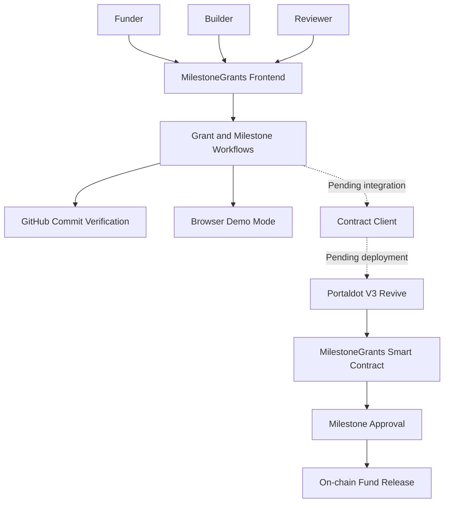

# MilestoneGrants — Product Architecture

## Overview

MilestoneGrants is a milestone-based grant distribution platform. It connects funders, builders and reviewers through a workflow designed to make grant funding transparent and accountable.

## Architecture Diagram

## Main Components

1. **Frontend:** Provides the user interface for funders, builders and reviewers.
2. **Grant and Milestone Workflows:** Handles grant creation, milestone claims and reviewer approvals.
3. **GitHub Verification:** Checks submitted commit references against GitHub.
4. **Demo Mode:** Provides a browser-based simulation of the grant lifecycle without requiring a deployed contract.
5. **Smart Contract:** Implements grant and milestone funding logic in Solidity.
6. **Portaldot Revive:** Intended blockchain execution environment for the smart contract.

## Deployment Status

The Solidity contract has been developed and compiled successfully. Deployment to Portaldot V3 Testnet remains pending. Consequently, the contract client, live blockchain interaction and on-chain fund release are not yet verified as operational.
